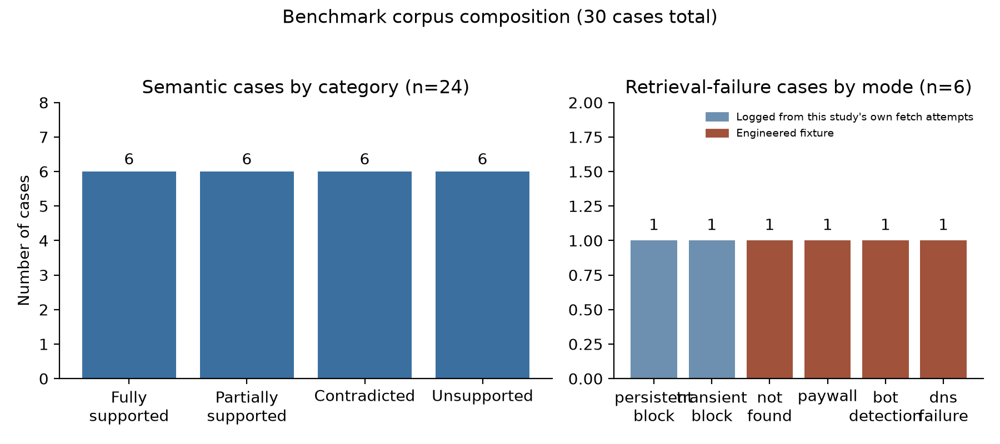

# 5. Benchmark Construction

## 5.1 What was built

Following the design frozen in Chapter 4, the benchmark corpus consists of 30 cases: 24 semantic cases (6 per category: fully supported, partially supported, contradicted, unsupported) used in the receiving-agent experiment, and 6 retrieval-failure cases held out and evaluated only against the Citation Binder (Chapter 6). The full, structured case set is in `report/data/benchmark-cases.json`; this chapter summarizes how it was built and what it contains, rather than reproducing all 30 cases in prose.

Figure 5.1 shows the realized composition.

*Figure 5.1. Left: the 24 semantic cases, evenly split across the four support categories as specified in Section 4.4. Right: the 6 retrieval-failure cases by failure mode. Two modes (persistent block, transient block) are logged directly from fetch attempts made during this study's own research process, rather than constructed; the remaining four are engineered fixtures, described in Section 5.4.*

## 5.2 Source material and why it was reused rather than freshly gathered

Every semantic case pairs a proposition with a source whose content this study had already independently verified while writing Chapters 1 and 2: the confirmed quotations and figures recorded in `references.md`. This was a deliberate choice, not a shortcut taken to save time without noting it. Authoring 24 new claim-source pairs from material never examined elsewhere in this project would have required a second, equally careful verification pass, duplicating work already done to the standard this project's own protocol requires, without adding independent value. Reusing already-verified passages means every source excerpt in the benchmark has a documented chain back to a primary source this study actually read, which a freshly assembled set would not automatically have.

This choice has a cost, disclosed here rather than left implicit. Several of the sources used (Gong et al. 2026, AVeriTeC, ALCE, SourceCheckup, ClaimArena-LLM, CiteEval, and others) are discussed at length earlier in this same report, and some may also appear in a receiving model's own pretraining data. A receiving agent could, in principle, recognize a source and recall a figure from prior exposure rather than reading the passage actually given to it in a trial. This risk is narrower than it would be for an open-book factual-recall task: the benchmark's task is not "what does this paper find," it is "does this specific passage support this specific proposition," so a model still has to check the given text against the given proposition to produce a component-level assessment, and several propositions (the partially-supported and contradicted cases in particular) are constructed so that a memorized headline figure is not sufficient to answer correctly. But the risk is not eliminated, and Chapter 7 is expected to report, for each case, whether the receiving model shows any sign of citing facts not present in the passage it was actually given, as a check for this specific failure mode.

## 5.3 Labeling procedure

Each of the 24 semantic cases was labeled twice, in two separate passes against the written category rubric in Section 4.4, by the same person (the sole annotator for this benchmark; see Section 4.4 for why no second annotator was available and what that limitation means for this benchmark's validity). The two passes agreed on category label and relevance flag for all 24 cases; no case required rewriting to resolve a disagreement in this round. That agreement is a property of a single annotator being consistent with their own rubric across two readings, not independent validation, and is reported here as exactly that, not inflated into an inter-annotator agreement statistic it is not.

Each case additionally records a relevance flag, separate from the support label, as specified in Section 4.4. Two of the six unsupported cases (U1, U2) are off-topic: the cited source does not address the proposition's subject matter at all. The remaining four unsupported cases (U3 through U6) are topically relevant but insufficient: the source is about the right subject, but does not establish the specific proposition attached to it. This split exists because a receiving agent that is good at recognizing irrelevance but bad at recognizing insufficiency, or the reverse, would look identical under a single undifferentiated "unsupported" label, and Chapter 8 can only report that distinction if the benchmark records it.

## 5.4 Retrieval-failure cases

Two of the six retrieval-failure cases are not constructed examples. They are logged directly from this study's own fetch attempts, made in the course of writing Chapters 1 and 2:

- **R1**, the ClaimArena-LLM article page, returned HTTP 403 Forbidden on every direct fetch attempt made during this project, including a retry made specifically to re-check it on 2026-11-14. This is a persistent block: nothing about the retries suggested it would resolve on its own.
- **R2**, CiteEval's ACL Anthology page, failed with an access error on three separate attempts, then returned a complete HTTP 200 response on a fourth attempt minutes later, also on 2026-11-14. This is a transient block: identical requests to the identical URL failed and then succeeded within the same research session.

These two real, dated failures were kept as cases specifically because they illustrate a distinction a citation-verification pipeline needs to make and could easily get wrong: treating a transient failure as if it were permanent would cause a Citation Binder to wrongly discard a real, retrievable source, while treating a persistent failure as if a retry might fix it would waste time without ever producing an answer.

The remaining four cases (R3 through R6) are engineered fixtures, explicitly labeled as such in `benchmark-cases.json` and not drawn from this study's actual reference list: a simulated 404 Not Found, a simulated paywall (the page loads but returns a subscription notice instead of the cited content), a simulated bot-detection interstitial (the page loads but returns a challenge page instead of content), and a simulated DNS failure (the domain does not resolve at all). These were constructed because this study's own research process happened to produce real examples of only two failure modes, and a Citation Binder that only ever sees those two would be evaluated on a narrower range of failure handling than the kinds of failures citation-verification systems need to survive in general.

## 5.5 Revision: two cases corrected after the Citation Binder run

**2026-11-15.** Two of the original six partially-supported cases, P2 and P5, were replaced after the Citation Binder (Chapter 6) was run against them. Both originally paired a true sub-component with a second sub-component that directly contradicted its source (P2 claimed AVeriTeC's documented verdict was "incorrect" when the source states it was true; P5 claimed Gong et al. found upstream-message removal "fully restored" accuracy "in every case" when the source says it "recovers part of the lost accuracy"). Under this study's own rollup rule, stated explicitly in Section 4.8 of the methodology after this discovery ("contradicted if any component is contradicted"), both cases should have been labeled contradicted from the start, not partially supported.

This was caught because the Citation Binder, applying that same rollup rule independently and mechanically, classified both cases as contradicted, diverging from the ground truth this study had assigned. The divergence was then checked by hand against the actual source text, not accepted on the Citation Binder's authority; the Citation Binder's output is not ground truth any more than the original label was. The check confirmed the Citation Binder's classification was correct and the original ground-truth label was not. P2 and P5 were rewritten with new source-proposition pairs that actually fit the partially-supported category (a confirmed component paired with a genuinely unaddressed, unverifiable addition, rather than a direct contradiction), and a replacement Citation Binder run was performed on the two corrected cases only. A third case, P3, was checked against the same rollup rule and deliberately kept unchanged: it is the cherry-picking sub-case the rollup rule explicitly carves out (Section 4.8), where a true subset figure is presented as if it described the full population. The Citation Binder, which was not given this carve-out explicitly, also classified P3 as contradicted; that divergence is reported in Chapter 6 as a limitation of the Citation Binder's current rollup logic, not as a further benchmark defect.

This is recorded here, with the original incorrect labels described rather than silently removed, because a single-annotator benchmark (Section 5.3) is exactly the kind of artifact where this class of error is likely, and an external, independently-applied check, even an imperfect automated one, surfacing it is the system working as intended rather than a failure to hide.

## 5.6 What this chapter does not yet establish

This chapter documents the benchmark as built. It makes no claim about how well the Citation Binder or any receiving model performs against it; that is Chapters 6 through 8. It also does not claim the 24 semantic cases are representative of the full space of real-world citation misuse, a claim the single-annotator, reused-source construction described above would not support. The benchmark is a frozen instrument built to the standard Chapter 4 specifies, nothing more.
