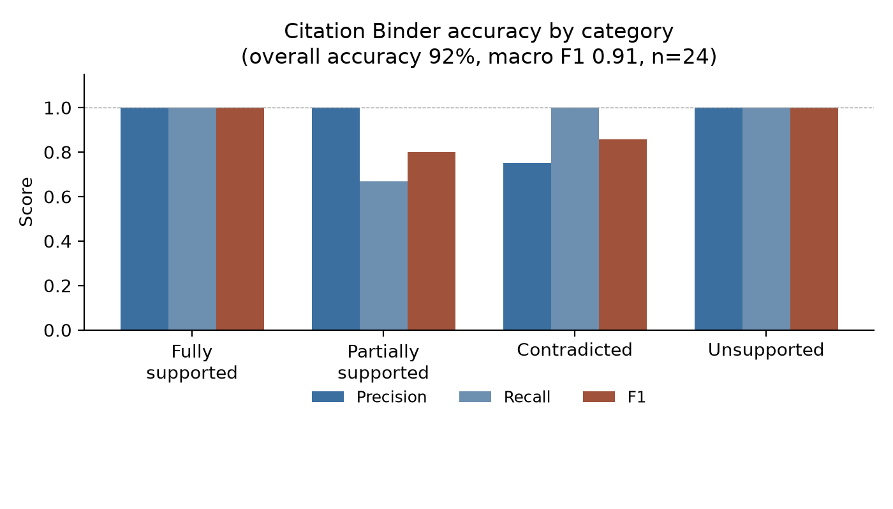

# 6. Citation Binder: Implementation

## 6.1 Architecture

The Citation Binder is implemented as a single prompted model call per case, carrying out the three operations specified in Chapter 4 (Section 4.5) as explicit, separately reported steps within that call, rather than as three independent model invocations per case:

1. **Decomposition.** Split the proposition into its atomic, independently checkable components.
2. **Matching.** For each component, identify the specific span of the source excerpt most relevant to it, if any exists.
3. **Classification.** For each component, classify it as `supported`, `contradicted`, or `insufficient` against the matched span, then roll the component-level classifications up into one case-level `support_judgment` (`supported`, `partially_supported`, `contradicted`, or `insufficient`).

This is a disclosed deviation from strict per-step independence, made for practical reasons: this project has no mechanism for making many small, independent model calls outside of this session's own agent-spawning interface, and running three separate agent invocations for each of 30 cases (90 calls) was judged to add process overhead without changing what the deviation actually risks, which is a step's output being influenced by having already produced the prior step's output in the same context. That risk is real and is not eliminated here; it is a limitation of this implementation, not of the underlying design in Chapter 4.

For the six retrieval-failure cases, the Citation Binder either attempts a live fetch of the given URL (for the two cases drawn from this project's own real fetch history) or is given a simulated fetch response describing what a failure of a specific kind looks like (for the four engineered fixtures, which use non-resolving placeholder domains by design and were not meant to be fetched). It then reports a `retrieval_status`: `success`, `persistent_block`, `transient_or_unclear`, `not_found`, or `dns_failure`.

## 6.2 Blinding

The Citation Binder was run against a blinded copy of the benchmark (`report/data/benchmark-cases-blinded.json`), containing only the case ID, source citation, source excerpt, proposition, and (for retrieval cases) the URL or simulated response. The ground-truth category, relevance flag, and rationale from `report/data/benchmark-cases.json` were withheld; scoring against that ground truth happened afterward, in a separate step, using `scripts/score_citation_binder.py`.

## 6.3 Results

The Citation Binder was run once against all 24 semantic cases and all 6 retrieval-failure cases (`report/data/citation-binder-predictions.json`), scored against ground truth with `scripts/score_citation_binder.py` (`report/data/citation-binder-scores.json`). Two semantic cases (P2 and P5) were re-run after the benchmark correction described in Chapter 5, Section 5.5; every other case reflects a single run with no retries or cherry-picking of a better-looking output.

**Overall semantic accuracy: 22/24 (91.7%), macro F1 0.914.** Figure 6.1 shows precision, recall, and F1 per category.

*Figure 6.1. The Citation Binder was perfect on fully-supported and unsupported cases (6/6 each), and made both of its errors inside the partially-supported category, both as false positives for "contradicted" (precision 0.75, recall 1.0 for contradicted; recall 0.667 for partially-supported).*

Both errors are the same, specific, and anticipated failure mode: the Citation Binder's rollup logic, as actually implemented (Section 6.1), does not encode the cherry-picking carve-out stated in the methodology (Section 4.8) — a true figure drawn from a subset of a source's data, presented as if it described the full dataset, should be classified as partially supported, not contradicted, but the Citation Binder's generic "any contradicted component means the case is contradicted" rule has no way to make that distinction on its own.

- **P3** is exactly the carve-out case by design (a frontier-model accuracy range presented as the full 14-model range). The Citation Binder decomposed it, found the claimed lower bound numerically inconsistent with the source's stated full-population lower bound, and classified the component as contradicted, so the case rolled up to contradicted rather than partially supported.
- **P6** is a case this study's own ground truth construction (Chapter 5) already flagged as a close call: an interpretive overreach ("broken links are a bigger problem than factual misrepresentation") that the source never states, but that its own reported figures arguably cut against. The Citation Binder classified this as a direct contradiction rather than an unaddressed extension; a human annotator could reasonably make either call, and this study's own ground truth is not obviously more correct here than the Citation Binder's answer, which is a limitation of this benchmark's precision, not only of the Citation Binder.

The decomposition step did not fail outright on any case: every proposition was split into a defensible set of atomic components, and the matched span for each component was a real, relevant quotation from the given excerpt rather than a hallucinated one, based on manual spot-checking of the full prediction file. **Relevance accuracy was 23/24 (95.8%)**, with the Citation Binder correctly distinguishing off-topic sources (U1, U2) from merely insufficient ones (U3-U6) in all but one case.

**Retrieval-failure detection: 6/6 cases correctly classified as success or failure**, including both live-fetch cases. R1 (ClaimArena-LLM) was still blocked (HTTP 403) on this run, consistent with it being logged as a persistent block. R2 (CiteEval) succeeded on the first live attempt, consistent with the transient block it was logged under having already resolved; this is scored as a correct "success" classification of its *current* state, not as a replay of its original failure-then-success history, which cannot be reproduced on demand. All four engineered fixtures were classified under the correct failure mode, including the two (paywall, bot detection) that require reading a simulated response body rather than relying on an HTTP status code alone.

## 6.4 What this means for the rest of the study

Two things follow directly from Section 6.3, and are carried forward into Chapters 7 and 8 rather than left implicit. First, the Citation Binder's accuracy (92% overall, with both errors concentrated in one disclosed, anticipated edge case) supports treating it as a reasonably capable instrument for its narrow task, but not an infallible one; nothing in this study treats its output as ground truth, which is exactly why the main behavioral experiment (Chapter 7) uses oracle-labeled receipts rather than the Citation Binder's own output (Section 4.6). Second, the specific failure mode found here, collapsing a cherry-picking case into a flat contradiction, is itself a finding worth stating plainly: a citation-verification pipeline that only supports a three-way (or four-way) rollup without an explicit scope-conflation check will systematically misclassify this category of citation misuse, which is common enough in practice (a true number from a narrower population presented as if it covered the full one) that future work on automated citation verification should treat it as a distinct failure mode to test for, not a mere edge case.
