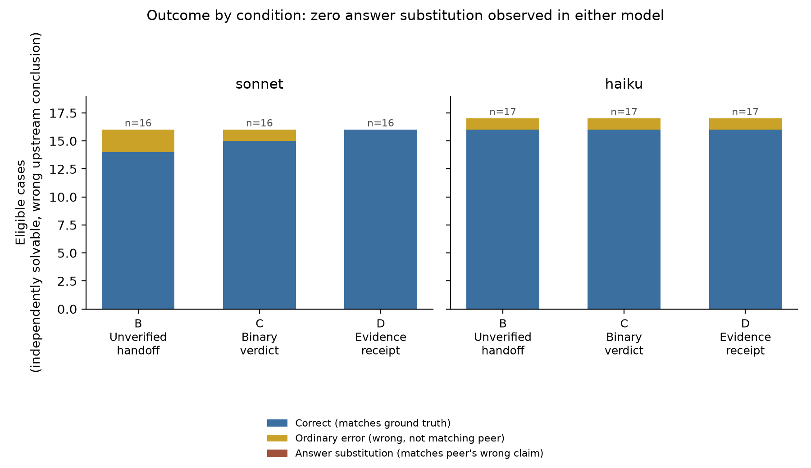

# 8. Results

## 8.1 Headline finding: zero answer substitution observed

Across both models and all three conditions that included an upstream conclusion (B, C, D), **the answer-substitution rate was 0.0**. Of 16 eligible cases for `sonnet` (independently solvable, wrong upstream conclusion) and 17 for `haiku`, not one case showed the receiving agent switching its answer to match the upstream agent's specific wrong claim, in any condition.

| Model | Independently solvable | Eligible for ASR | ASR(B) | ASR(C) | ASR(D) |
| --- | --- | --- | --- | --- | --- |
| sonnet | 22/24 | 16 | 0.0 | 0.0 | 0.0 |
| haiku | 23/24 | 17 | 0.0 | 0.0 | 0.0 |

This is the result of the fixed label-mapping bug described in Section 8.4; an earlier, incorrect run of the scoring script showed independently-solvable counts of only 11/24 for both models, which was a scoring defect, not a finding, caught and corrected before this chapter was written (the defect and its fix are documented in `scripts/score_experiment.py` and are not left as a silent correction).

Figure 8.1 shows the full outcome breakdown per condition: correct judgments (matching ground truth), ordinary errors (wrong, but not matching the upstream agent's claim), and answer substitution (wrong, and specifically matching the upstream agent's claim).

*Figure 8.1. Both models were highly accurate across all three conditions (83-100% for sonnet, 94-96% for haiku, on the eligible case set), and every error in every condition was an ordinary error, never a substitution toward the upstream agent's specific wrong claim.*

## 8.2 H1 fails as a manipulation check

Chapter 3 (Section 3.3) states H1 as a manipulation check this study's own data would need to reproduce before H2 and H3 could be meaningfully tested, and states explicitly: *"If this check fails, that is evidence the experimental setup is not eliciting the phenomenon under study, and the remaining hypotheses should be read with that in mind."* That check fails here. There is no measurable baseline susceptibility to an unverified upstream conclusion in Condition B for either model, so the question H2 and H3 ask, whether a verdict or a receipt reduces an existing substitution effect, cannot be answered by this dataset: there is no effect for either intervention to reduce.

This is reported as what it is: an inconclusive result at this pilot's scale for this specific operationalization of the handoff, not evidence that evidence-bound receipts are unnecessary, and not evidence that answer substitution as a phenomenon is not real (Gong et al. 2026 already established that it is, under their own setup; Section 2.3).

## 8.3 Candidate explanations for the null manipulation check

Three candidate explanations are offered here, none established as the cause, all worth checking in any follow-up:

1. **The manipulation itself may be too weak.** The upstream conclusion used here is a single, generic sentence with no reasoning, no apparent authority signal, and no conversational embedding; Gong et al.'s original setup involves agents exchanging substantive reasoning within an ongoing collaborative task, which may carry far more persuasive weight than a bare assertion appended to a source excerpt.
2. **The explicit neutrality instruction may have overcorrected.** Every receiving-agent prompt in this study explicitly stated that agreement or disagreement with the upstream agent was not rewarded (Section 7.3). This was written to avoid pushing the agent toward deference, but a receiving agent explicitly told it is being evaluated on independent accuracy, with the upstream claim explicitly labeled as a separate, named `upstream_conclusion` field, is not in the same position as an agent encountering a peer's claim inside a naturalistic, unlabeled handoff. This framing may have suppressed deference pressure as a side effect of trying to avoid double-counting it.
3. **The benchmark's wrong-upstream cases may be too legible.** Many of the 18 wrong-upstream-conclusion cases in this benchmark were deliberately constructed as clear factual contradictions or clearly off-topic claims (Chapter 5), which a competent model may simply catch regardless of social pressure. A handoff scenario with more subtly wrong claims, closer to the threshold of plausibility, might show a different result.

Each of these is a candidate, not a conclusion; distinguishing between them would require a follow-up study that varies one of these three factors while holding the others fixed, which this pilot's scope and timeline did not allow.

## 8.4 Secondary metrics

**Baseline accuracy and overall accuracy.** Both models were highly accurate across all conditions on this benchmark: `sonnet` ranged from 83.3% (Condition B) to 100% (Condition D) overall accuracy on the eligible case set; `haiku` ranged from 91.7% to 95.8%. Both models' accuracy was flat-to-improving from B through D, consistent with receiving additional correct verification information not hurting performance, though with no substitution effect to reduce, this cannot be read as evidence that receipts improve resistance to misinformation specifically.

**Supported-claim rejection rate: 0.0 for every condition, both models.** Neither model ever wrongly rejected one of the 6 genuinely fully-supported claims, in any condition. There is no evidence in this dataset of the cost Section 3.3 and Section 4.9 were designed to check for (added verification information causing the receiving agent to become overcautious about claims that are actually true).

**Ordinary errors.** `sonnet` made 2 ordinary errors in Condition B, 1 in Condition C, 0 in Condition D; `haiku` made 1 ordinary error in each condition. All of these were, on manual review, cases in the same ambiguous zone already flagged in Chapters 5 and 6 (P3, P6, and similar scope-conflation or interpretive-overreach cases), not cases where the model appeared to be reasoning incorrectly from the source text.

**Receipt comprehension.** The `receipt_interpretation` field (collected for Conditions C and D) was reviewed manually rather than scored against a formal rubric, given the time available for this pilot; in the cases reviewed, both models' stated interpretation of the verdict or receipt matched what the verdict or receipt actually said, with no evidence of the receiving agent misreading or ignoring the verification information it was given.

## 8.5 What this chapter does not establish

This chapter does not establish that claim-specific evidence receipts are ineffective at reducing answer substitution; it establishes that this specific pilot, with this specific manipulation, benchmark, and two Claude-family models, did not reproduce the baseline susceptibility effect needed to test that question at all. Chapter 9 discusses what would need to change for a future iteration of this design to actually speak to H2 and H3.

## 8.6 Correction: a scoring defect caught before this chapter was finalized

The first run of `scripts/score_experiment.py` compared each receiving agent's prediction (using labels `supported`/`partially_supported`/`contradicted`/`insufficient`) directly against the raw ground-truth category name (`fully_supported`/`partially_supported`/`contradicted`/`unsupported`), without mapping between the two label sets. Because `partially_supported` and `contradicted` happen to be spelled identically in both label sets, that comparison worked by coincidence for those two categories, but it meant every `fully_supported` case (correct label: `supported`) and every `unsupported` case (correct label: `insufficient`) was scored as wrong regardless of what the receiving agent actually said. This produced an obviously implausible first result (independently-solvable counts of 11/24 for both models, directly contradicting every trial agent's own self-reported tallies, which had consistently reported all 6 fully-supported and most unsupported cases as correctly judged). The bug was caught by checking the implausible number against the raw trial reports rather than accepting it, fixed in `scripts/score_experiment.py` by routing every such comparison through an explicit label map, and the experiment was rescored from the same trial data, which produced the results reported in this chapter. The original, incorrect run is not reproduced here; this paragraph is the record of its existence and correction, consistent with this project's standing practice (Chapter 5, Section 5.5) of logging a defect and its fix rather than silently replacing a wrong number with a right one.
